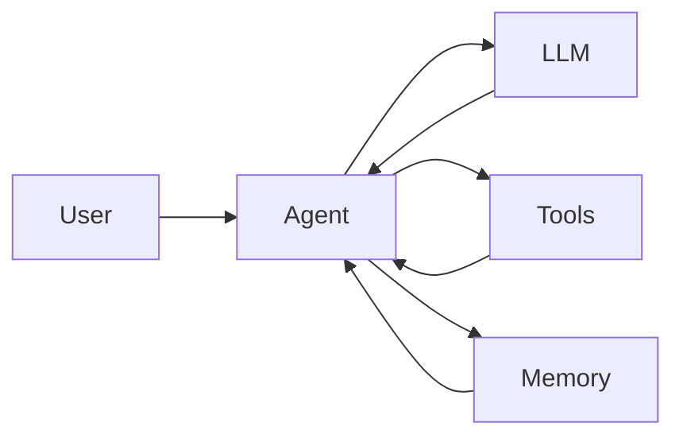

## 什么是 Agent？

Agent（智能体）是能够自主感知环境、做出决策并执行动作的 AI 系统。与传统的单次问答不同，Agent 具备以下核心能力：

```
用户提问 → Agent 规划 → 调用工具 → 观察结果 → 反思调整 → 输出结果
```

简单来说：**LLM 是大脑，Agent 是能动手的大脑**。

## Agent 的核心架构

一个典型的 Agent 包含以下几个关键组件：

- **LLM Core**：负责理解、推理、规划
- **Memory**：短期记忆（对话上下文）+ 长期记忆（向量数据库）
- **Tools**：可调用的外部能力（搜索、代码执行、API 等）
- **Planning**：任务分解与执行策略

## 数学公式示例

$$
E = mc^2
$$

## Mermaid 图表示例



这是一篇用于验证新前端 MD 渲染能力的示例文章。
