**部署目标**

本次部署服务器为 `43.136.136.167`，最终结果：

```text
公开博客：http://43.136.136.167/
管理后台：http://43.136.136.167/admin/
后端 API：http://43.136.136.167/api/v1/health
```

线上结构：

```text
GitHub main 分支
  -> 服务器拉取项目代码
  -> site 构建博客静态站点
  -> admin/frontend 构建管理前端
  -> admin/backend 通过 systemd 常驻运行
  -> Nginx 提供静态站点、/admin/ Basic Auth 和 /api/ 反向代理
```

安全目标：

- `/admin/` 使用 Nginx Basic Auth。
- `/api/` 不再使用 Nginx Basic Auth，避免和前端 Bearer Token 共用 `Authorization` 请求头导致浏览器反复弹窗；业务 API 继续由后端 token 鉴权保护。
- 后端服务只监听 `127.0.0.1:18000`。
- 服务器密码、后台密码、token 密钥不写入文章和截图。

---

**一、服务器初始化**

登录服务器并确认系统：

```bash
ssh ubuntu@43.136.136.167
whoami && hostname && lsb_release -a
```

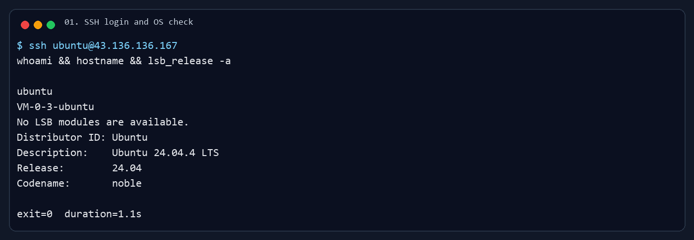

安装基础组件：

```bash
sudo apt update
sudo apt install -y nginx git curl rsync apache2-utils ufw ca-certificates gnupg
```

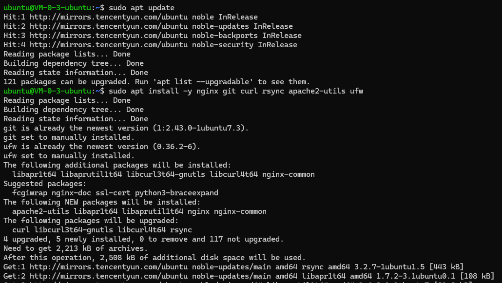

安装 Node.js 20：

```bash
curl -fsSL https://deb.nodesource.com/setup_20.x -o /tmp/nodesource_setup_20.sh
sudo bash /tmp/nodesource_setup_20.sh
sudo apt install -y nodejs
node -v
npm -v
```

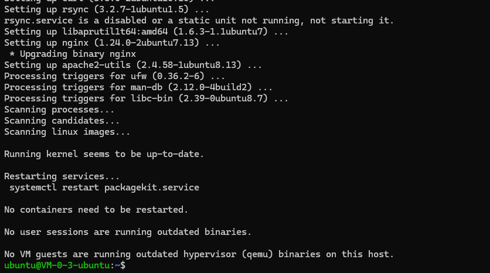

安装 `uv` 和 Python 3.10：

```bash
curl -LsSf https://astral.sh/uv/install.sh | sh
~/.local/bin/uv --version
~/.local/bin/uv python install 3.10
~/.local/bin/uv python list | grep 'cpython-3.10'
```

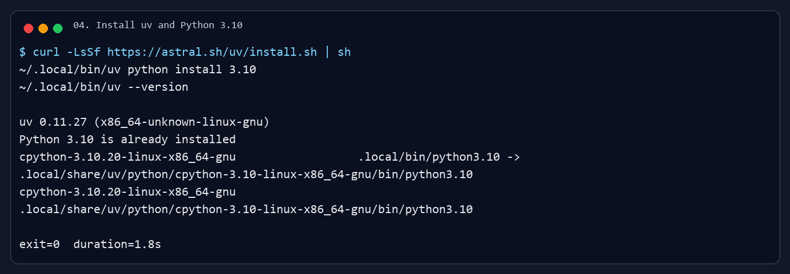

创建部署目录：

```bash
mkdir -p /home/ubuntu/lucan/xiaocancoding
sudo chown -R ubuntu:ubuntu /home/ubuntu/lucan
ls -ld /home/ubuntu/lucan /home/ubuntu/lucan/xiaocancoding
```

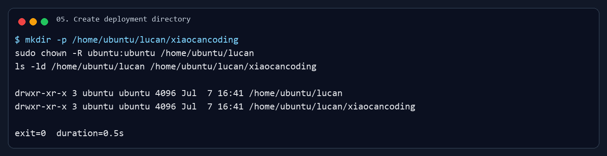

配置防火墙，只开放 SSH、HTTP、HTTPS：

```bash
sudo ufw allow OpenSSH
sudo ufw allow 80/tcp
sudo ufw allow 443/tcp
sudo ufw --force enable
sudo ufw status verbose
```

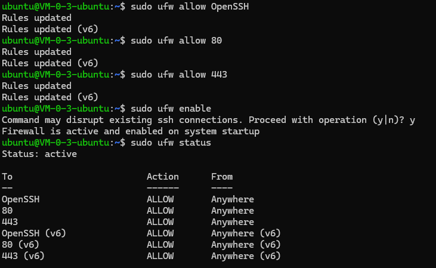

---

**二、拉取项目代码**

原计划使用 `develop`，但部署时发现远端 `develop` 落后，GitHub 上可直接拉取的最新公开代码在 `main`。最终成功部署使用 `main` 分支。

第一次拉取时 GitHub TLS 中断，报错截图放在问题记录中。修复后执行：

```bash
cd /home/ubuntu/lucan/xiaocancoding
git config --global http.version HTTP/1.1

# 如果上次 clone 中断留下了半截目录，先删除半截目录
rm -rf app

git clone --depth 1 -b main https://github.com/lucan6290/lucan6290.github.io.git app
cd /home/ubuntu/lucan/xiaocancoding/app
git branch --show-current
git rev-parse --short HEAD
git remote -v
```


后续更新不需要重新 clone：

```bash
cd /home/ubuntu/lucan/xiaocancoding/app
git fetch origin
git checkout main
git pull --ff-only origin main
```

---

**三、配置管理端访问密码**

管理端采用两层保护：

```text
第一层：Nginx Basic Auth，只保护 /admin/
第二层：项目自己的后台登录，保护业务 API
```

创建 Basic Auth 文件：

```bash
sudo htpasswd -c -B /etc/nginx/.htpasswd_xiaocan lucan
```

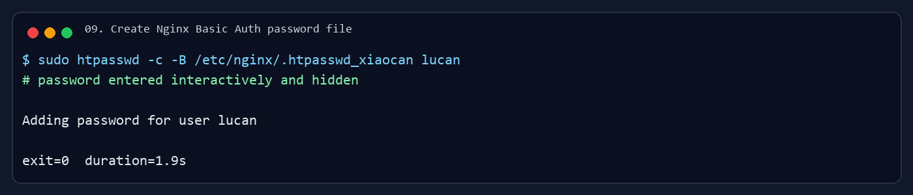

---

**四、配置后端环境变量**

进入后端目录并创建 `.env`：

```bash
cd /home/ubuntu/lucan/xiaocancoding/app/admin/backend

cat > .env <<'EOF'
LUCHUAN_ENV=prod
LUCHUAN_PROJECT_ROOT=/home/ubuntu/lucan/xiaocancoding/app
LUCHUAN_LOG_LEVEL=INFO
LUCHUAN_CORS_ORIGINS=http://43.136.136.167
LUCHUAN_ADMIN_USERNAME=lucan
LUCHUAN_ADMIN_PASSWORD=<部署时输入的后台登录密码>
LUCHUAN_AUTH_SECRET=<随机 token 签名密钥>
LUCHUAN_AUTH_TOKEN_TTL_MINUTES=720
EOF

chmod 600 .env
ls -l .env
```

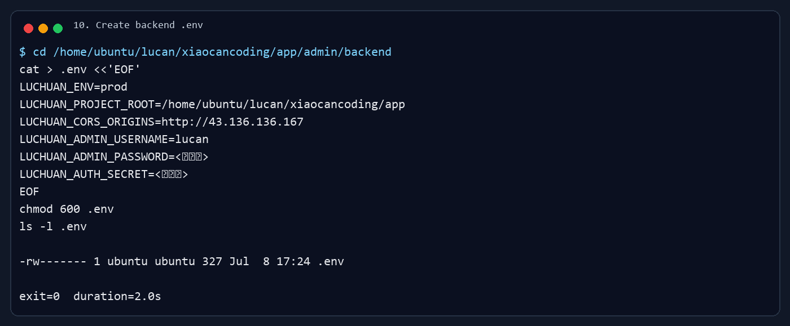

---

**五、安装后端依赖**

第一次把创建虚拟环境和安装依赖合在一起执行时超时，报错截图放在问题记录中。最终拆成两步执行成功：

```bash
cd /home/ubuntu/lucan/xiaocancoding/app/admin/backend
rm -rf .venv
~/.local/bin/uv venv --python /home/ubuntu/.local/share/uv/python/cpython-3.10-linux-x86_64-gnu/bin/python3.10 .venv
.venv/bin/python --version
```

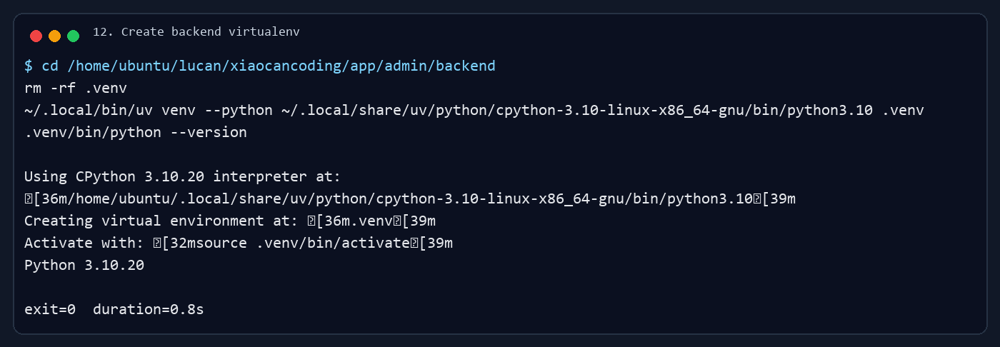

```bash
cd /home/ubuntu/lucan/xiaocancoding/app/admin/backend
~/.local/bin/uv pip install --python .venv/bin/python -r requirements.txt
```


---

**六、构建博客前端**

```bash
cd /home/ubuntu/lucan/xiaocancoding/app/site
npm ci
npm run build
```

构建产物：

```text
/home/ubuntu/lucan/xiaocancoding/app/site/build
```


---

**七、构建管理前端**

管理前端源码会把 `VITE_API_BASE_URL` 和 `/api/v1` 拼接，所以不能写成 `VITE_API_BASE_URL=/api`，否则会请求 `/api/api/v1/...`。

第一次执行 `npm ci` 失败，原因是 `package-lock.json` 与 `package.json` 不同步。最终在服务器上使用 `npm install` 完成安装和构建：

```bash
cd /home/ubuntu/lucan/xiaocancoding/app/admin/frontend
npm install
VITE_API_BASE_URL=http://43.136.136.167 npm run build
```

构建产物：

```text
/home/ubuntu/lucan/xiaocancoding/app/admin/frontend/dist
```


---

**八、配置后端 systemd 服务**

```bash
sudo tee /etc/systemd/system/xiaocan-admin-backend.service >/dev/null <<'EOF'
[Unit]
Description=Xiaocan Coding Admin Backend
After=network.target

[Service]
User=ubuntu
WorkingDirectory=/home/ubuntu/lucan/xiaocancoding/app/admin/backend
EnvironmentFile=/home/ubuntu/lucan/xiaocancoding/app/admin/backend/.env
ExecStart=/home/ubuntu/lucan/xiaocancoding/app/admin/backend/.venv/bin/python -m uvicorn scr.main:app --host 127.0.0.1 --port 18000
Restart=always
RestartSec=5

[Install]
WantedBy=multi-user.target
EOF

sudo systemctl daemon-reload
sudo systemctl enable xiaocan-admin-backend
sudo systemctl restart xiaocan-admin-backend
sudo systemctl status xiaocan-admin-backend --no-pager -l
```


---

**九、处理 Nginx 静态文件读取权限**

因为站点放在 `/home/ubuntu/...` 下，Nginx 的 `www-data` 用户需要穿透父目录并读取构建产物：

```bash
chmod o+x /home/ubuntu /home/ubuntu/lucan /home/ubuntu/lucan/xiaocancoding /home/ubuntu/lucan/xiaocancoding/app
cd /home/ubuntu/lucan/xiaocancoding/app
find site/build admin/frontend/dist -type d -exec chmod 755 {} \;
find site/build admin/frontend/dist -type f -exec chmod 644 {} \;
```

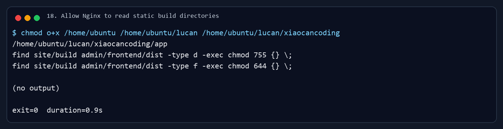

---

**十、配置 Nginx**

```bash
sudo tee /etc/nginx/sites-available/xiaocancoding >/dev/null <<'EOF'
server {
    listen 80;
    server_name 43.136.136.167;

    root /home/ubuntu/lucan/xiaocancoding/app/site/build;
    index index.html;

    location / {
        try_files $uri $uri/ /404.html;
    }

    location = /admin {
        return 301 /admin/;
    }

    location /admin/ {
        auth_basic "Xiaocan Admin";
        auth_basic_user_file /etc/nginx/.htpasswd_xiaocan;

        alias /home/ubuntu/lucan/xiaocancoding/app/admin/frontend/dist/;
        try_files $uri $uri/ /admin/index.html;
    }

    location /api/ {
        proxy_pass http://127.0.0.1:18000;
        proxy_http_version 1.1;
        proxy_set_header Host $host;
        proxy_set_header X-Real-IP $remote_addr;
        proxy_set_header X-Forwarded-For $proxy_add_x_forwarded_for;
        proxy_set_header X-Forwarded-Proto $scheme;
    }
}
EOF

sudo ln -sf /etc/nginx/sites-available/xiaocancoding /etc/nginx/sites-enabled/xiaocancoding
sudo rm -f /etc/nginx/sites-enabled/default
sudo nginx -t
sudo systemctl reload nginx
```

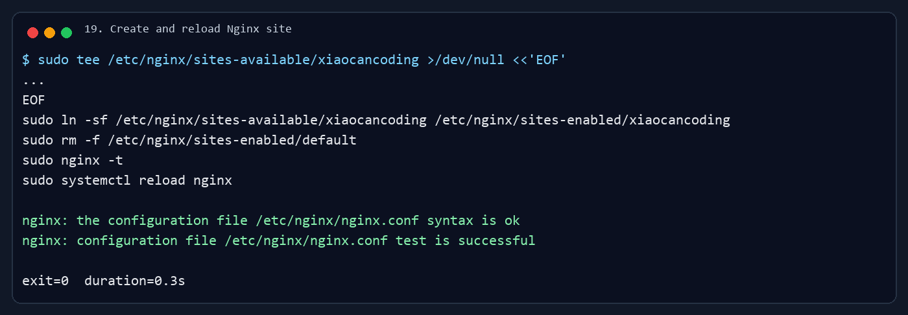

---

**十一、部署结果验证**

服务器内部验证：

```bash
sudo systemctl is-active xiaocan-admin-backend
sudo nginx -t
curl -I http://127.0.0.1/
curl http://127.0.0.1:18000/api/v1/health
```


本地电脑第一次验证时，curl 走了本机代理，所以这些截图只作为排查记录，不作为最终判断：

```bash
curl -I http://43.136.136.167/
curl -I -u lucan:<已隐藏> http://43.136.136.167/admin/
curl http://43.136.136.167/api/v1/health
curl --connect-timeout 5 http://43.136.136.167:18000/api/v1/health
```


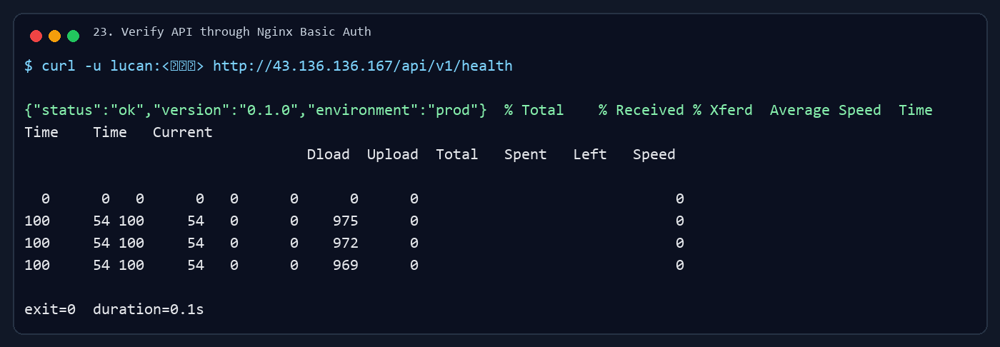

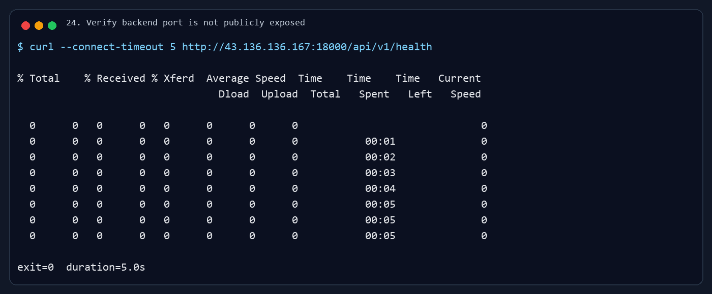

最终改用 `--noproxy "*"` 做直接公网验证。

博客首页公开访问：

```bash
curl --noproxy "*" -I http://43.136.136.167/
```


匿名访问 `/admin/` 返回 `401 Unauthorized`：

```bash
curl --noproxy "*" -I http://43.136.136.167/admin/
```

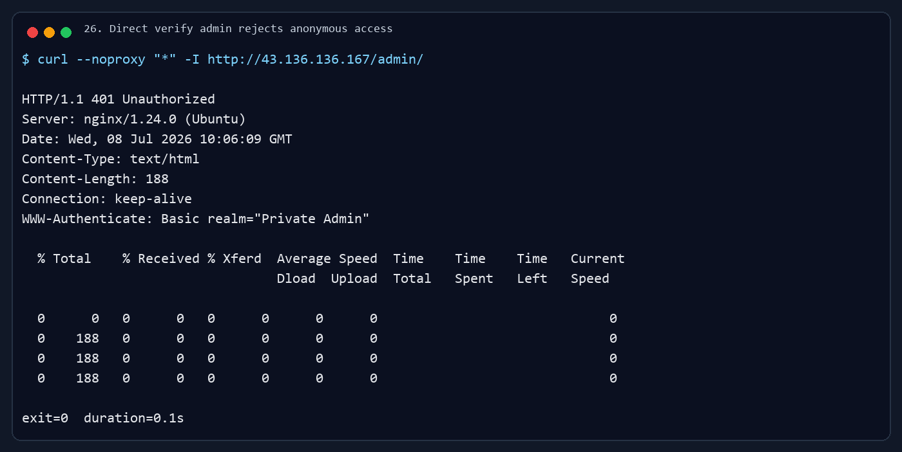

带 Basic Auth 访问 `/admin/` 返回 `200 OK`：

```bash
curl --noproxy "*" -I -u lucan:<已隐藏> http://43.136.136.167/admin/
```


直接访问 API 健康检查。这里不再加 Nginx Basic Auth，避免和后台前端请求业务接口时携带的 Bearer Token 冲突：

```bash
curl --noproxy "*" http://43.136.136.167/api/v1/health
```

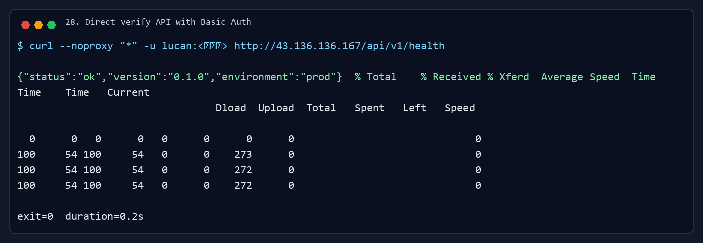

直连公网 `18000` 超时，说明后端端口没有直接暴露：

```bash
curl --noproxy "*" --connect-timeout 5 http://43.136.136.167:18000/api/v1/health
```

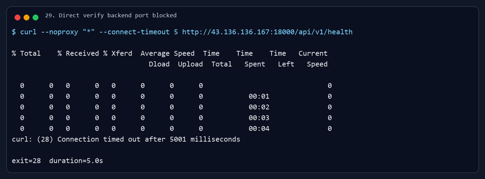

---

**十二、部署过程中遇到的问题**

1. `git clone` 时 TLS 中断

报错提醒：

```text
fatal: unable to access 'https://github.com/lucan6290/lucan6290.github.io.git/':
GnuTLS recv error (-110): The TLS connection was non-properly terminated.
```

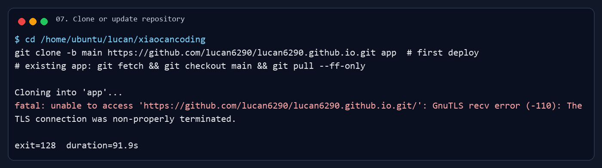

原因：服务器到 GitHub 的 HTTPS 连接中途断开，第一次 clone 留下了不完整的 `app` 目录。

最终解决方案：

```bash
git config --global http.version HTTP/1.1
rm -rf /home/ubuntu/lucan/xiaocancoding/app
git clone --depth 1 -b main https://github.com/lucan6290/lucan6290.github.io.git app
```

个人思考：远程部署时，GitHub 网络抖动很常见。失败后不要直接重复 clone 到同一个半截目录，先清理再重试更稳。

2. 后端依赖安装首次超时

报错提醒：

```text
TimeoutError: remote command timeout: Install backend dependencies
```

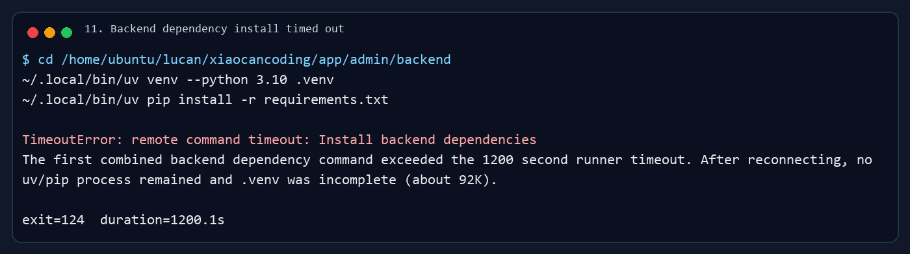

原因：第一次把 `uv venv` 和 `uv pip install` 合在一个长命令里执行，依赖安装耗时超过了自动化脚本 1200 秒超时限制；重连检查后发现 `.venv` 未完整安装。

最终解决方案：拆成创建虚拟环境和安装 requirements 两步，并把安装依赖的超时时间放长。

个人思考：部署文档里可以合并命令，但真实自动化执行时，长耗时步骤最好拆开。这样失败时能知道到底卡在下载 Python、创建 venv，还是安装依赖。

3. 管理前端 `npm ci` 失败

报错提醒：

```text
npm error `npm ci` can only install packages when your package.json and package-lock.json are in sync.
npm error Missing: @emnapi/core@1.11.2 from lock file
npm error Missing: @emnapi/runtime@1.11.2 from lock file
```


原因：远端仓库里的 `admin/frontend/package-lock.json` 没有同步最新依赖树，`npm ci` 严格校验时直接失败。

最终解决方案：本次服务器部署先使用 `npm install` 生成可用依赖树并完成构建。

个人思考：这类问题最终应该回到本地修复 lockfile 并提交，而不是长期依赖服务器上的 `npm install`。生产部署更推荐 `npm ci`，前提是 lockfile 必须准确。

4. 管理前端 API 基础地址不能写成 `/api`

报错提醒：这是源码检查发现的潜在问题，不是终端报错。前端封装中已经有 `API_PREFIX = '/api/v1'`，如果构建时写 `VITE_API_BASE_URL=/api`，最终会请求 `/api/api/v1/...`。

原因：环境变量和代码里的 API 前缀重复了。

最终解决方案：

```bash
VITE_API_BASE_URL=http://43.136.136.167 npm run build
```

个人思考：部署前要读一眼前端请求封装，尤其是 `baseURL` 和路径前缀的组合方式。Nginx 里叫 `/api/`，不代表前端环境变量也一定要写 `/api`。

5. 本地 curl 默认走代理，影响端口暴露判断

报错提醒：第一次本地验证响应头中出现 `Proxy-Connection`，直连 `18000` 时还返回了代理侧的 `502 Bad Gateway`，不能作为服务器端口暴露结论。

原因：本机 curl 使用了代理环境。

最终解决方案：公网验证全部加上：

```bash
curl --noproxy "*"
```

个人思考：验证“端口是否公网暴露”必须尽量走直连，否则测到的可能是本机代理或公司网络代理的行为。

6. `/api/` 同时套 Nginx Basic Auth 会导致浏览器反复弹窗

报错提醒：浏览器已经进入 `/admin/#/` 后，页面运行过程中仍持续弹出 `http://43.136.136.167` 的登录窗口。

原因：浏览器 Basic Auth 和后台应用登录后的 Bearer Token 都使用 HTTP `Authorization` 请求头。前端请求业务 API 时会发送：

```text
Authorization: Bearer <后台登录 token>
```

这个请求头会覆盖浏览器自动附加的 Basic Auth 凭据，导致 Nginx 认为 `/api/` 没有通过 Basic Auth，于是返回 `401` 并让浏览器继续弹窗。

最终解决方案：Nginx Basic Auth 只保护 `/admin/`，`/api/` 只做反向代理，业务接口继续由后端自己的 token 鉴权保护。

个人思考：Basic Auth 适合保护静态管理入口，但不适合继续套在需要 Bearer Token 的 API 外层。两者共用 `Authorization` 头，叠在一起很容易出现这种看似“登录失效”的循环弹窗。

---

**十三、后续更新部署流程**

后续更新执行：

```bash
ssh ubuntu@43.136.136.167

cd /home/ubuntu/lucan/xiaocancoding/app
git checkout main
git pull --ff-only origin main

cd /home/ubuntu/lucan/xiaocancoding/app/site
npm ci
npm run build

cd /home/ubuntu/lucan/xiaocancoding/app/admin/frontend
npm install
VITE_API_BASE_URL=http://43.136.136.167 npm run build

cd /home/ubuntu/lucan/xiaocancoding/app/admin/backend
~/.local/bin/uv pip install --python .venv/bin/python -r requirements.txt

sudo systemctl restart xiaocan-admin-backend
sudo nginx -t
sudo systemctl reload nginx
```

---

**最终部署结果**

```text
公开博客：http://43.136.136.167/
管理后台：http://43.136.136.167/admin/
后端 API：http://43.136.136.167/api/v1/health

部署分支：main
后端服务：xiaocan-admin-backend
后端监听：127.0.0.1:18000
公网开放：22、80、443
公网未开放：18000、14000、3400
```
