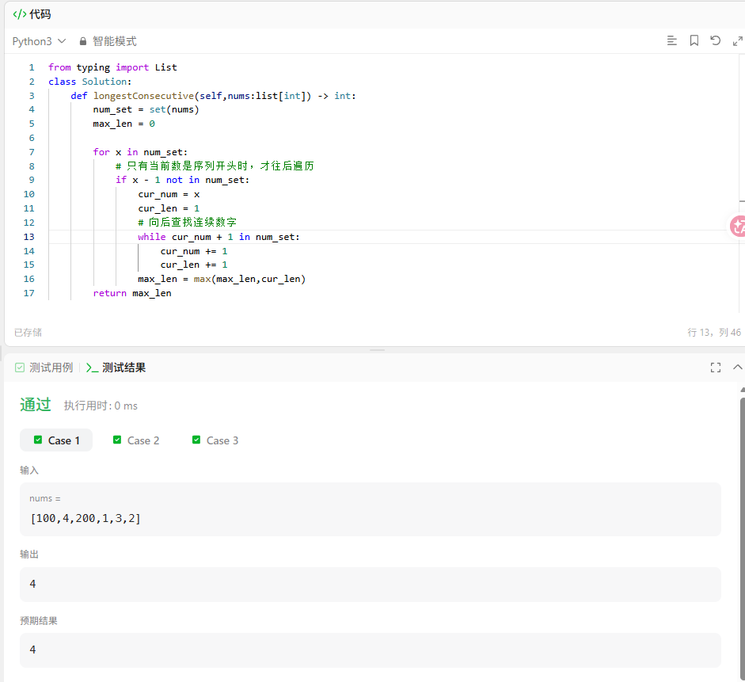

# 题目


# 题解
## 核心思路
1. 先把数组转为**集合**，查询元素是否存在时间复杂度 O(1)，同时自动去重；
2. 遍历集合中每个数字 `x`，**只从连续序列的起点开始向后枚举**：
   - 判断 `x-1` 是否不在集合里 → 说明 `x` 是一段连续序列最左端起点；
   - 从起点不断找 `x+1、x+2...`，统计当前序列长度；
3. 全程每个元素最多被访问2次，整体时间复杂度 O(n)，满足题目进阶要求。

```python
from typing import List

class Solution:
    def longestConsecutive(self, nums: List[int]) -> int:
        num_set = set(nums)
        max_len = 0

        for x in num_set:
            # 只有当前数是序列开头时，才往后遍历
            if x - 1 not in num_set:
                cur_num = x
                cur_len = 1
                # 向后查找连续数字
                while cur_num + 1 in num_set:
                    cur_num += 1
                    cur_len += 1
                max_len = max(max_len, cur_len)
        return max_len
```

---

## 分步举例演示（输入 `[100,4,200,1,3,2]`）
1. 集合：`{100,4,200,1,3,2}`
2. 遍历`100`：`99`不在集合，开始往后找，只有100自身，长度=1，最大值=1
3. 遍历`4`：`3`在集合，跳过，不开启遍历
4. 遍历`200`：`199`不在集合，长度=1，最大值不变
5. 遍历`1`：`0`不在集合，依次找到2、3、4，长度=4，最大值更新为4
6. 遍历`3`：`2`在集合，跳过
7. 遍历`2`：`1`在集合，跳过
最终返回最大值`4`。

---

## 关键细节说明
### 1. 为什么要判断 `x-1 not in num_set`？
避免重复遍历同一段连续序列。
比如序列`1,2,3,4`，只在`x=1`时完整遍历一次；遍历2/3/4时直接跳过，不会重复循环，保证复杂度为线性。

### 2. 集合去重作用
输入如`[1,0,1,2]`，集合会自动变成`{0,1,2}`，不会因为重复数字重复统计长度。

### 3. 边界兼容
- 空数组`nums = []`：直接返回`0`；
- 单元素数组：返回`1`，代码天然兼容无需额外判断。

## （排序 O(nlogn)）
如果没有复杂度限制，可以排序后遍历统计：
```python
def longestConsecutive(self, nums: List[int]) -> int:
    if not nums:
        return 0
    nums.sort()
    max_len, cur = 1, 1
    for i in range(1, len(nums)):
        if nums[i] == nums[i-1]:
            continue
        elif nums[i] == nums[i-1] + 1:
            cur += 1
            max_len = max(max_len, cur)
        else:
            cur = 1
    return max_len
```
